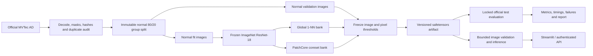
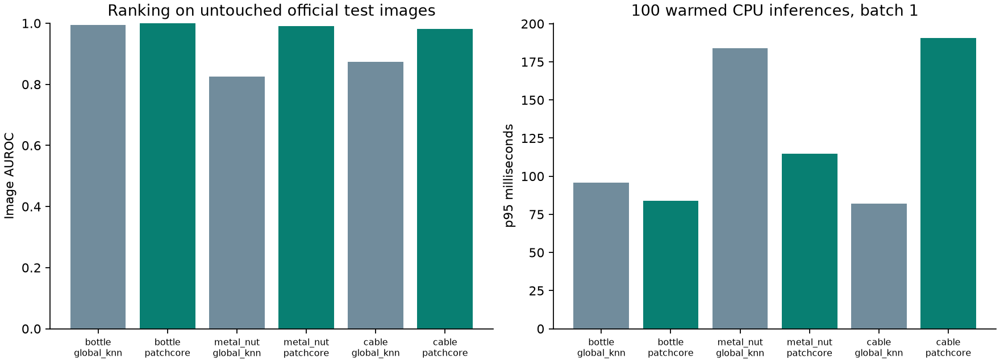

# VisualGuard AI · Industrial anomaly detection

Learn normal appearance, locate unusual regions, and keep the evidence behind every result.
VisualGuard compares a frozen **ResNet-18 global 1-NN baseline** with **Anomalib PatchCore**
on MVTec AD, with leakage checks, normal-only threshold calibration, a Streamlit dashboard,
and a bounded inspection API.

[](https://github.com/jeelthacker1/visualguard-industrial-anomaly-detection/actions/workflows/ci.yml)

**Research question:** Does local feature matching improve defect detection and localization
over a global representation, and what are its memory and CPU-time costs?

This is a measured research prototype. A normal-appearance result does not certify a part
as safe. Public GitHub source does not mean that an internet-facing inference service is hosted.

## Demo

On Windows with Python 3.13 installed, run `powershell -ExecutionPolicy Bypass -File .\run.ps1`.
This installs the locked environment, creates synthetic fixtures, trains a software-demo
model and opens the Streamlit server. Upload an image from
`local_data/synthetic/synthetic_part/test/`.
Use `-Mode test` for automated checks, `-Mode study` for the full real-data study after
obtaining the official archive, and `-Mode app` for existing trained artifacts.

Run `python -m streamlit run app/streamlit_app.py` after training, then open
[the local dashboard](http://127.0.0.1:8501). Select a category-specific model and upload a
PNG/JPEG. The app shows the raw score, fixed threshold, acquisition warnings, measured
inspection time, and PatchCore's continuous heatmap, overlay and binary mask. It exports
inspection JSON and overlays without saving uploaded images on the server.

[Demo walkthrough](docs/demo_script.md) · [Measured results and failures](reports/RESULTS.md) ·
[Technical report](docs/technical_report.md) · [Model card](docs/model_card.md)

## Architecture



## Why normal-only learning?

Defects can be rare and diverse. This project learns a reference for normal products and
scores deviations instead of training a binary classifier on labeled defects. It uses
ImageNet features, so it is not a claim of learning every visual feature from unlabeled data.
Each product category has its own bank. There is no automatic cross-category recognition.

## Dataset and split

Download [MVTec AD from its creators](https://www.mvtec.com/research-teaching/datasets/mvtec-ad).
It is licensed **CC BY-NC-SA 4.0**, including a non-commercial restriction. Dataset images,
masks and trained artifacts are excluded from Git. The code's MIT license does not change
their terms. Complete the publisher's download form and save the full archive as
`local_data/mvtec_anomaly_detection.tar.xz`. Alternatively, supply the download link from
the form through the local `MVTEC_AD_DOWNLOAD_URL` environment variable. The downloader
verifies the full official archive's SHA-256 before extracting
bottle, metal_nut and cable. Allow approximately 15 GiB free for download/extraction.

```text
local_data/MVTecAD/<category>/
  train/good/*.png                 -> 80% fit / 20% normal calibration
  test/good/*.png                  -> untouched official evaluation
  test/<defect>/*.png              -> untouched official evaluation
  ground_truth/<defect>/*_mask.png  -> evaluation only
```

Splits, masks and files are validated and fingerprinted. Exact duplicates cannot cross
splits; same-item groups can be supplied explicitly. Near duplicates are flagged for review,
not silently removed. See [the complete evaluation protocol](docs/methodology.md), including
perceptual-hash false alarms and unknown physical-item independence.

## Methods

**Global baseline:** one 512-dimensional frozen ResNet-18 embedding per normal image;
minimum Euclidean distance to the normal bank. It has no pixel-localization claim.

**PatchCore:** Anomalib's actual layer2/layer3 model, coreset selection, nearest-patch distances,
weighted image score and anomaly-map generator. A seeded cap of 20,000 candidate patches
keeps the CPU experiment practical; the library retains 5% or 10% of those candidates.
This cap is explicitly reported and differs from full-candidate PatchCore configurations.

Thresholds use only held-out normal validation scores (99th percentile, `higher` interpolation).
Scores are distances, **not failure probabilities**. Official test labels never set thresholds.

## Install and reproduce

Tested target: **Python 3.13**, Windows CPU. The dependency lock records the actual tested
environment. The original plan proposed Python 3.11; the delivered target follows the
available and verified runtime. GitHub CI checks lightweight tests on Windows and Linux.

```powershell
python -m venv .venv
.\.venv\Scripts\python.exe -m pip install --upgrade pip==26.3
.\.venv\Scripts\python.exe -m pip install -r requirements-lock.txt
.\.venv\Scripts\python.exe -m pip install -e . --no-deps
.\.venv\Scripts\python.exe -m visualguard.cli doctor
```

The following commands assume that environment is activated. On systems without activation,
replace `python` with its `.venv` executable. Linux/macOS use `.venv/bin/python`.

```powershell
python scripts/download_mvtec.py
# First training downloads ImageNet weights; later artifact inference is offline.
python -m visualguard.cli prepare --root local_data/MVTecAD --category bottle --manifest runs/my_bottle.csv
python -m visualguard.cli train --root local_data/MVTecAD --manifest runs/my_bottle.csv --config configs/baseline.yaml --output artifacts/my_baseline
python -m visualguard.cli train --root local_data/MVTecAD --manifest runs/my_bottle.csv --config configs/patchcore_resnet18.yaml --output artifacts/my_patchcore
python -m visualguard.cli evaluate --root local_data/MVTecAD --manifest runs/my_bottle.csv --artifact artifacts/my_patchcore --output runs/my_evaluation
python -m streamlit run app/streamlit_app.py
```

To reproduce the fixed ten-run study, first populate the expected local weight cache:

```powershell
$env:HF_HOME = "$PWD/.cache/huggingface"
$env:TORCH_HOME = "$PWD/.cache/torch"
$env:MPLCONFIGDIR = "$PWD/.cache/matplotlib"
python -c "import timm; timm.create_model('resnet18.tv_in1k', pretrained=True)"
python scripts/run_study.py --output-root runs/reproduction
python scripts/export_report.py --root runs/reproduction/reports
```

The study runner goes offline for model weights, checks the frozen plan/config hashes, and
preserves existing evidence. The commands above put your independent reproduction in a new
directory. Use a new `--output-root` for another run. See [operations](docs/operations.md) for
crash/repeat handling.

For a dataset-free **software-only** smoke test:

```powershell
python -m visualguard.cli synthetic --output local_data/synthetic
python -m visualguard.cli prepare --root local_data/synthetic --category synthetic_part --manifest runs/smoke.csv
python -m visualguard.cli train --root local_data/synthetic --manifest runs/smoke.csv --config configs/smoke.yaml --output artifacts/synthetic
```

These fixtures and random-weight models test engineering behavior. They are never reported
as industrial detection accuracy.

## Results and performance

[Full measured table](reports/RESULTS.md) · [Machine-readable comparison](reports/comparison.csv)



Every run includes raw continuous predictions, fixed-threshold false alarms/missed defects,
AUROC/AP, image-bootstrap intervals, pixel AUROC/AUPRO where supported, bank size and hardware.
Timing records 100 warmed batch-one CPU calls. It excludes file decode, UI and transport;
the separate inspection latency includes decode/quality checks. No hard real-time guarantee
or universal accuracy percentage is asserted. The single-seed study does not establish
multi-seed robustness. See the report for both successful detections and failure identifiers.

## Tests and safety

```powershell
python -m ruff check .
python -m ruff format --check .
python -m pytest -q
python -m pip_audit
```

Tests cover content/group leakage, duplicate images, file and artifact tampering, mask resize,
nearest-neighbor mathematics, threshold provenance, tied-score AUPRO, unknown uploads,
timestamp freshness, stale replay, API auth, rate limits, concurrency and model round trips.
PR CI uses synthetic data with no large downloads; full model integration is also available
through manual workflow dispatch. [Verification record](reports/verification.json).

The API requires a local secret, bounded body size, one concurrent inspection, fresh frame
timestamps and unique capture IDs. Invalid inputs are rejected; model errors, quality shifts
and deadline overruns require review. These are engineering controls, not safety certification.
[Security model](SECURITY.md) · [API and deployment guide](docs/operations.md)

## Original work and attribution

The project-specific contribution is the audit/split pipeline, independent calibration,
artifact integrity, controlled comparison, exact PRO integration with tests, bounded inspection
API, dashboard, reproducibility scripts and honest failure reporting. **ResNet, ImageNet,
PatchCore, MVTec AD and Anomalib are external work.** Implementation was developed with AI
coding assistance; this repository does not claim unaided authorship or a novel detector.

- Bergmann et al. (CVPR 2019), [MVTec AD](https://openaccess.thecvf.com/content_CVPR_2019/html/Bergmann_MVTec_AD_--_A_Comprehensive_Real-World_Dataset_for_Unsupervised_Anomaly_CVPR_2019_paper.html).
- Roth et al. (CVPR 2022), [Towards Total Recall in Industrial Anomaly Detection](https://openaccess.thecvf.com/content/CVPR2022/html/Roth_Towards_Total_Recall_in_Industrial_Anomaly_Detection_CVPR_2022_paper.html).
- [Anomalib](https://github.com/open-edge-platform/anomalib), Apache-2.0.
- [timm](https://github.com/huggingface/pytorch-image-models) and [torchvision](https://github.com/pytorch/vision), model implementation and ImageNet weight lineage; see their licenses/model cards.

See [limitations](docs/limitations.md), [the model card](docs/model_card.md) and [CITATION.cff](CITATION.cff).
